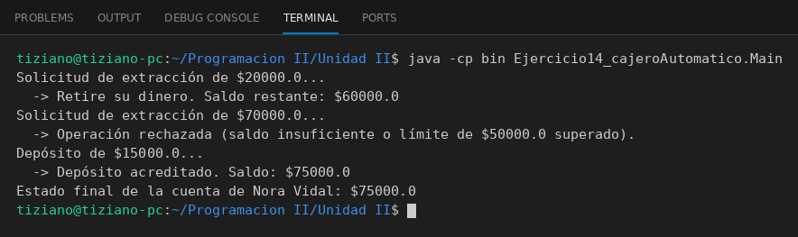

# CajeroAutomatico

Programación II - Unidad 2 - Ejercicio 14

## Consigna
Un cajero envía mensajes a una cuenta bancaria, que valida las operaciones y protege su saldo.

## Lógica
- `CuentaBancaria`: `cbu`, `titulares`, `saldo` (privado) y un límite de extracción; `debitar` y `acreditar` retornan un booleano.
- `debitar` rechaza montos no positivos, mayores al saldo o al límite.
- `CajeroAutomatico`: referencia a la cuenta en sesión; `extraerDinero` y `depositarDinero` envían el mensaje e informan el resultado.
- `Main`: extracción exitosa, extracción rechazada y depósito.

## Ejecución

